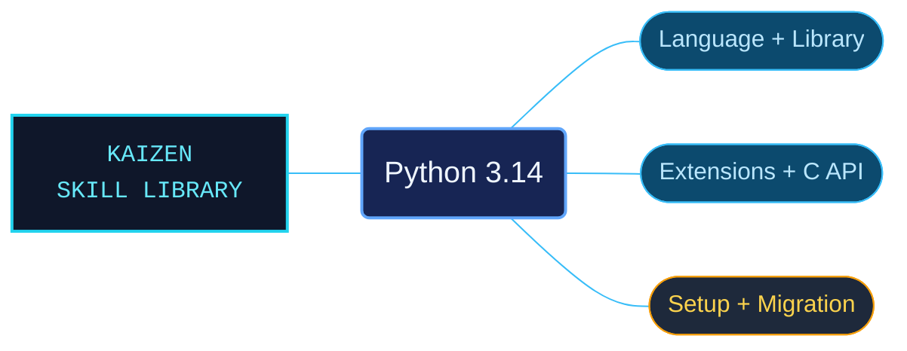

# Python 3.14

CPython 3.14 references spanning everyday Python development, interpreter setup and native extension work. Thirteen reference-area subskills separate tutorials, language contracts, standard-library APIs and historical changes so an agent can select the appropriate kind of evidence.

Use when writing, debugging or reviewing Python 3.14 (CPython): standard-library APIs, language syntax and object protocols, tutorials and HOWTOs, interpreter setup, package installation and distribution, C/C++ extensions, embedding and the Python/C API. Also use for bundled Python FAQs, terminology, version-specific release changes and deprecation schedules.

## What this skill helps with

| Task | Useful reference material |
| --- | --- |
| [Check language and library behavior](references/library/README.md) | Find standard-library APIs and use the language reference for syntax and object protocols. |
| [Apply focused techniques](references/howto/README.md) | Use task-oriented guides for concurrency, tooling and language features. |
| [Build native integrations](references/extending/README.md) | Follow extension and embedding guidance with linked C API contracts. |
| [Understand compatibility changes](references/deprecations/README.md) | Check replacements and removal schedules against their named Python versions. |

## Included reference-area subskills

| Subskill | Use it for |
| --- | --- |
| [Tutorial](references/tutorial/README.md) | Python concepts and examples for readers with programming experience. |
| [Language reference](references/reference/README.md) | Syntax, data model, execution, imports and grammar. |
| [Standard library](references/library/README.md) | Built-ins, modules and their API contracts. |
| [HOWTOs](references/howto/README.md) | Focused language, concurrency, tooling and debugging techniques. |
| [FAQs](references/faq/README.md) | Design, programming, platform, GUI and extension questions. |
| [Interpreter usage](references/using/README.md) | Installation, builds, invocation and platform configuration. |
| [Installing modules](references/installing/README.md) | The package-installation overview and links to detailed packaging guidance. |
| [Distributing modules](references/distributing/README.md) | The official overview and pointers to the Python Packaging User Guide. |
| [Extending and embedding](references/extending/README.md) | C/C++ extensions, custom types, linking and embedded interpreters. |
| [Python/C API](references/c-api/README.md) | Objects, protocols, reference ownership, runtime state and ABI contracts. |
| [Release changes](references/whatsnew/README.md) | Historical feature guides, porting notes and release records. |
| [Deprecations](references/deprecations/README.md) | Deprecated features, migration replacements and removal schedules. |
| [General reference](references/general/README.md) | Terminology, documentation origins and contributors. |

## The work behind the references

The documentation is organized into focused subject files with linked prerequisites, examples and continuations. The repair work reviewed code formatting and protected technical content alongside naming and navigation, retaining the version conditions around historical material.

## Start here

Start with [SKILL.md](SKILL.md) and follow its context routes.

Keep all thirteen areas together. The main reference target is CPython 3.14; historical release notes apply to their named versions. Installing and distributing modules are overview routes, not a bundled replacement for the entire Python Packaging User Guide.

## Sources and license

Skill reference documentation is interpreted content for use in open source projects. Check against [official documentation sources](https://docs.python.org/3.14/) when dealing with defects or issues that may come up from interpreting this skill's references.

Licensed under **Apache-2.0**; see [LICENSE](LICENSE). Part of the [Agent Kaizen](https://github.com/LevyBytes/agent-kaizen) skill library.
