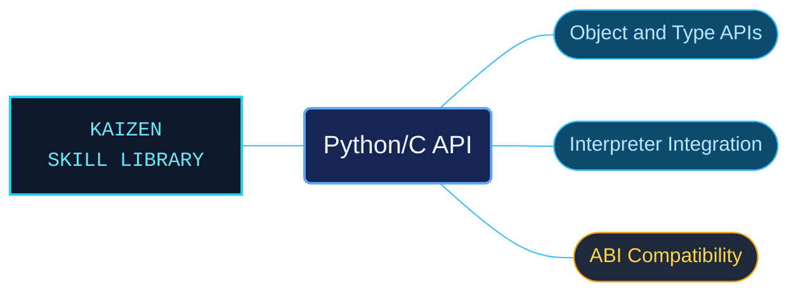

# Python/C API

CPython 3.14 C API references for implementing extension objects and embedding the interpreter. The material helps native-code authors locate object protocols, runtime requirements and compatibility boundaries before using an API.

Use when writing C/C++ extension modules or embedding CPython 3.14: Python objects, reference ownership, type layouts, object and container protocols, calls, buffers, Unicode, exceptions, memory, modules, interpreter initialization, GIL/thread state, subinterpreters, monitoring, or Stable/Limited/Unstable C API contracts. Not for ordinary Python-only application code or another Python version's undocumented behavior.

## What this skill helps with

| Task | Useful reference material |
| --- | --- |
| [Check object protocols](abstract-objects-layer/INDEX.md) | Find the generic object interfaces used by native extension code. |
| [Define extension modules](defining-extension-modules/INDEX.md) | Locate module definitions and their interpreter-facing contracts. |
| [Choose an ABI boundary](api-and-abi-versioning/INDEX.md) | Distinguish versioned API and ABI guarantees. |

## The work behind the references

Native interfaces are grouped by object family and runtime responsibility, retaining signatures, ownership conditions and version constraints with the reference prose.

## Start here

Start with [SKILL.md](SKILL.md) and follow its context routes.

Target the documented CPython version and ABI. Review reference ownership, thread state and interpreter-lifecycle requirements before adapting native examples.

## Sources and license

Skill reference documentation is interpreted content for use in open source projects. Check against [official documentation sources](https://docs.python.org/3.14/) when dealing with defects or issues that may come up from interpreting this skill's references.

Licensed under **Apache-2.0**; see [LICENSE](../../LICENSE). Part of the [Agent Kaizen](https://github.com/LevyBytes/agent-kaizen) skill library.
