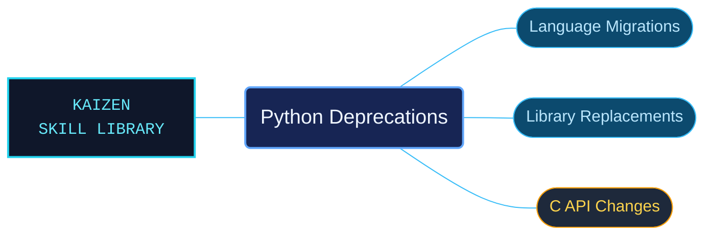

# Python Deprecations

Python compatibility references for identifying deprecated behavior and planning upgrades. Language, standard-library and C API changes are separated so removal schedules can be checked against the version actually being targeted.

Use when checking Python deprecated features, scheduled removal versions, migration replacements, compatibility shims, standard-library deprecations or C API removals in the bundled Python 3.14 documentation.

## What this skill helps with

| Task | Useful reference material |
| --- | --- |
| [Review language and library changes](language-library-removals/INDEX.md) | Locate deprecated features, replacements and documented removal versions. |
| [Review native API changes](c-api-removals/INDEX.md) | Find C API deprecations and migration requirements. |
| [Interpret version conditions](version-and-contract-conditions.md) | Keep scheduled removals distinct from deprecations without a fixed removal date. |

## The work behind the references

The material preserves the version attached to each change, with focused indexes for Python-level behavior and native extension contracts.

## Start here

Start with [SKILL.md](SKILL.md) and follow its context routes.

Use this as the bundled Python 3.14 deprecation reference. A historical schedule is evidence for its named release, not proof of the behavior of every installed interpreter.

## Sources and license

Skill reference documentation is interpreted content for use in open source projects. Check against [official documentation sources](https://docs.python.org/3.14/) when dealing with defects or issues that may come up from interpreting this skill's references.

Licensed under **Apache-2.0**; see [LICENSE](../../LICENSE). Part of the [Agent Kaizen](https://github.com/LevyBytes/agent-kaizen) skill library.
