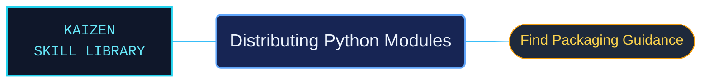

# Distributing Python Modules

A concise entrypoint to Python module distribution guidance. This reference area explains where the official overview ends and routes readers to the Python Packaging User Guide for the detailed packaging workflow.

Use when packaging or distributing your own Python modules: the official overview pointing to the Python Packaging User Guide, not the full packaging workflow.

## What this skill helps with

| Task | Useful reference material |
| --- | --- |
| [Find the distribution overview](orientation/distributing.md) | Read the bundled orientation and follow its authoritative packaging guidance. |

## The work behind the references

The distribution overview keeps its links to the Python Packaging User Guide and the project-packaging tutorial together.

## Start here

Start with [SKILL.md](SKILL.md) and follow its context routes.

Use the linked packaging documentation for detailed build, release and distribution procedures. This area does not bundle the full Python Packaging User Guide.

## Sources and license

Skill reference documentation is interpreted content for use in open source projects. Check against [official documentation sources](https://docs.python.org/3.14/) when dealing with defects or issues that may come up from interpreting this skill's references.

Licensed under **Apache-2.0**; see [LICENSE](../../LICENSE). Part of the [Agent Kaizen](https://github.com/LevyBytes/agent-kaizen) skill library.
