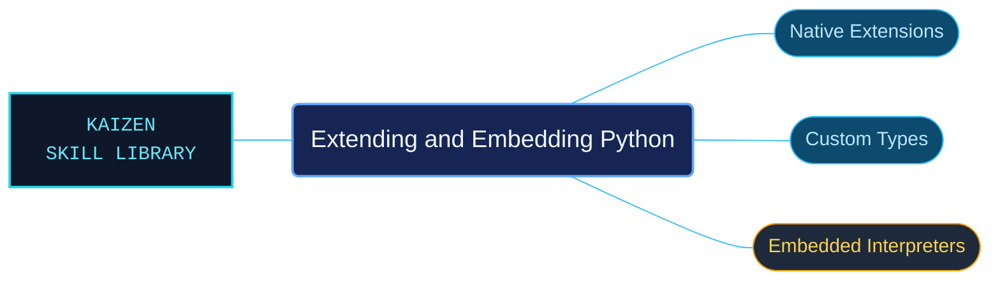

# Extending and Embedding Python

Python 3.14 guidance for building C/C++ extension modules and embedding CPython in another application. Topic routes connect native implementations with type behavior, interpreter setup and the build steps needed to integrate them.

Use for extending Python 3.14 with C/C++, implementing extension functions and custom types, parsing arguments, handling exceptions and reference ownership, defining type slots and cyclic-GC support, exposing capsule C APIs, embedding CPython, or compiling/linking extensions on Unix-like systems and Windows. This is how-to documentation with complete linked C examples, not a native execution result.

## What this skill helps with

| Task | Useful reference material |
| --- | --- |
| [Implement an extension type](extension-type-tutorial/INDEX.md) | Follow the custom-type tutorial and its linked complete examples. |
| [Embed the interpreter](embedding-python-in-another-application/INDEX.md) | Find application-level interpreter integration guidance. |
| [Build and link extensions](building-c-and-c-extensions/INDEX.md) | Check the documented compilation and linking workflow. |

## The work behind the references

Implementation guidance is organized by native integration task, keeping complete examples and linked ownership, argument-parsing and build requirements together.

## Start here

Start with [SKILL.md](SKILL.md) and follow its context routes.

Use the documented Python version and platform toolchain. Consult the Windows-specific route when applicable; reading or syntax-checking an example does not establish that it builds in a particular application.

## Sources and license

Skill reference documentation is interpreted content for use in open source projects. Check against [official documentation sources](https://docs.python.org/3.14/) when dealing with defects or issues that may come up from interpreting this skill's references.

Licensed under **Apache-2.0**; see [LICENSE](../../LICENSE). Part of the [Agent Kaizen](https://github.com/LevyBytes/agent-kaizen) skill library.
