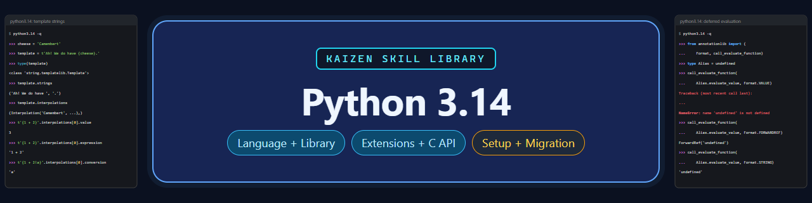

# Extending and Embedding Python: C and C++ extensions

Part of the [Python 3.14 agent skill](../../README.md), this subskill gives Claude Code, Codex and other coding agents 94 reference pages. It covers writing extension modules and custom extension types, building C and C++ extensions, Windows builds and embedding Python in another application. Its context router is [SKILL.md](SKILL.md) and its catalog is [INDEX.md](INDEX.md); it installs with the parent skill, as described in [Install](../../README.md#install).

**Status: early draft.** The reference pages and per-subskill reference checks are in place; scripts, assets and evaluations will be added over time.

## What's inside

| Starting point | Covers |
| --- | --- |
| [Implement an extension type](extension-type-tutorial/INDEX.md) | Follow the custom-type tutorial and its linked complete examples. 29 pages. |
| [Embed the interpreter](embedding-python-in-another-application/INDEX.md) | Find application-level interpreter integration guidance. 9 pages. |
| [Build and link extensions](building-c-and-c-extensions/INDEX.md) | Check the documented compilation and linking workflow. 3 pages. |

## When agents load this subskill

Use for extending Python 3.14 with C/C++, implementing extension functions and custom types, parsing arguments, handling exceptions and reference ownership, defining type slots and cyclic-GC support, exposing capsule C APIs, embedding CPython, or compiling/linking extensions on Unix-like systems and Windows.

## The work behind the references

Implementation guidance is organized by native integration task, keeping complete examples and linked ownership, argument-parsing and build requirements together. Examples assume the documented Python version and platform toolchain, with a separate route for Windows builds. Reading or syntax-checking an example does not establish that it builds in a particular application.

## Contributing

Contributions follow the parent skill's process: pull requests are accepted from approved contributors only, after the maintainer reviews and approves an issue. See [CONTRIBUTING](../../.github/CONTRIBUTING.md).

## Sources and license

Skill reference documentation is interpreted content for use in open source projects. Check against [official documentation sources](https://docs.python.org/3.14/) when dealing with defects or issues that may come up from interpreting this skill's references.

Licensed under **Apache-2.0**; see [LICENSE](../../LICENSE). Part of the [Agent Kaizen](https://github.com/LevyBytes/agent-kaizen) skill library.
