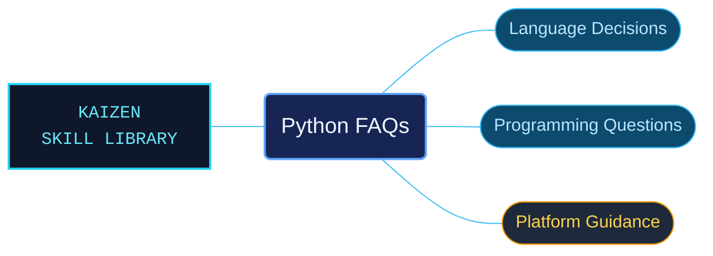

# Python FAQs

Python FAQ references for explaining language behavior, design choices and common platform questions. The question-oriented material complements the formal language and API references when a task needs rationale or troubleshooting context.

Use when answering Python FAQ questions about design, history, programming behavior, library tasks, extension or embedding interfaces, Windows execution, GUI toolkits, or why Python is installed.

## What this skill helps with

| Task | Useful reference material |
| --- | --- |
| [Explain language design](design/INDEX.md) | Find documented reasons behind Python language choices. |
| [Investigate programming behavior](programming/INDEX.md) | Look up common coding questions and their explanations. |
| [Answer Windows questions](windows/INDEX.md) | Locate platform-specific execution and installation guidance. |

## The work behind the references

FAQ subjects remain grouped by the question being answered, with separate routes for general, library, extension and graphical-interface topics.

## Start here

Start with [SKILL.md](SKILL.md) and follow its context routes.

Read answers in their documented version and platform context. Use the standard-library or language-reference area when the task needs a formal API or syntax contract.

## Sources and license

Skill reference documentation is interpreted content for use in open source projects. Check against [official documentation sources](https://docs.python.org/3.14/) when dealing with defects or issues that may come up from interpreting this skill's references.

Licensed under **Apache-2.0**; see [LICENSE](../../LICENSE). Part of the [Agent Kaizen](https://github.com/LevyBytes/agent-kaizen) skill library.
