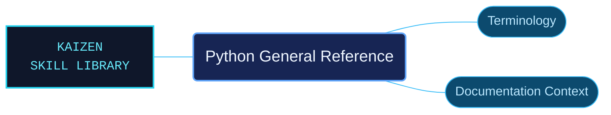

# Python General Reference

Python terminology and documentation-context references for interpreting the rest of the package accurately. The area brings together the glossary, documentation origins and contribution context.

Use when checking Python glossary definitions and terminology, documentation origins and contributors, or bug-reporting guidance in the bundled Python 3.14 documentation.

## What this skill helps with

| Task | Useful reference material |
| --- | --- |
| [Resolve terminology](glossary/INDEX.md) | Look up the documented meaning of Python terms. |
| [Understand documentation context](documentation/INDEX.md) | Find documentation origins, contributors and related guidance. |

## The work behind the references

Definitions and documentation history have their own routes.

## Start here

Start with [SKILL.md](SKILL.md) and follow its context routes.

Use this area when a term or provenance question affects how a technical reference should be interpreted.

## Sources and license

Skill reference documentation is interpreted content for use in open source projects. Check against [official documentation sources](https://docs.python.org/3.14/) when dealing with defects or issues that may come up from interpreting this skill's references.

Licensed under **Apache-2.0**; see [LICENSE](../../LICENSE). Part of the [Agent Kaizen](https://github.com/LevyBytes/agent-kaizen) skill library.
