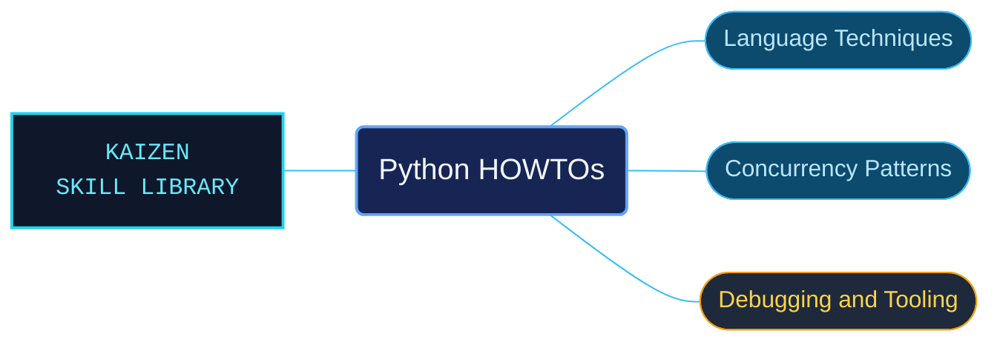

# Python HOWTOs

Task-oriented Python guidance for techniques that need more context than an API entry. The HOWTO collection connects language features, concurrency and development tools through focused explanations and examples.

Use when applying Python HOWTO guidance: asyncio, argparse, curses, descriptors, enums, functional programming, sorting, regular expressions, Unicode, networking, logging, free threading, extension isolation, annotations, migration, GDB, tracing, profiling or remote debugging.

## What this skill helps with

| Task | Useful reference material |
| --- | --- |
| [Understand asynchronous execution](a-conceptual-overview-of-asyncio/INDEX.md) | Read the conceptual guide before selecting lower-level asyncio APIs. |
| [Design application logging](logging-cookbook/INDEX.md) | Find logging patterns and their associated setup. |
| [Work with free-threaded Python](free-threading-python/INDEX.md) | Check the documented conditions and limitations of free-threaded execution. |
| [Understand descriptors](descriptor/INDEX.md) | Follow the language technique and its documented protocol behavior. |

## The work behind the references

The guides preserve their individual subject and historical context, with linked examples and focused indexes for techniques such as descriptors, argparse, annotations and extension isolation.

## Start here

Start with [SKILL.md](SKILL.md) and follow its context routes.

Select the guide for the task and retain its named Python version and platform. Historical porting guides apply to the versions they describe.

## Sources and license

Skill reference documentation is interpreted content for use in open source projects. Check against [official documentation sources](https://docs.python.org/3.14/) when dealing with defects or issues that may come up from interpreting this skill's references.

Licensed under **Apache-2.0**; see [LICENSE](../../LICENSE). Part of the [Agent Kaizen](https://github.com/LevyBytes/agent-kaizen) skill library.
