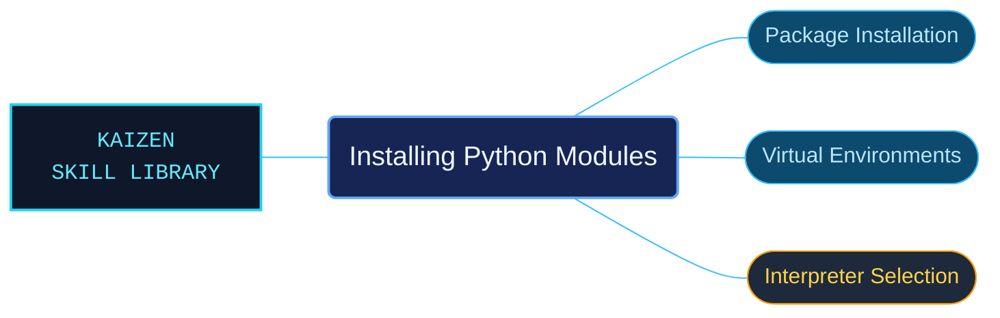

# Installing Python Modules

A concise Python package-installation overview for choosing the intended interpreter and environment. It covers the bundled pip and virtual-environment orientation and points to the detailed packaging guides when more depth is needed.

Use when installing Python packages: the official overview of pip, virtual environments and the detailed packaging guides, not the full packaging workflow.

## What this skill helps with

| Task | Useful reference material |
| --- | --- |
| [Install and update packages](orientation/install-version-pin-upgrade-and-use-virtual-environments.md) | Find the overview of version selection, upgrades and virtual environments. |
| [Choose the installation context](orientation/per-user-scientific-and-multiple-interpreter-installation.md) | Review per-user and multiple-interpreter considerations. |
| [Diagnose setup limitations](orientation/system-python-safety-missing-pip-and-binary-extensions.md) | Check system-interpreter, pip and binary-extension concerns. |

## The work behind the references

The overview is kept separate from the external packaging guides, preserving the boundary between bundled orientation and detailed installation procedures.

## Start here

Start with [SKILL.md](SKILL.md) and follow its context routes.

Confirm which interpreter and environment a command targets. Follow the linked official packaging documentation for the full workflow.

## Sources and license

Skill reference documentation is interpreted content for use in open source projects. Check against [official documentation sources](https://docs.python.org/3.14/) when dealing with defects or issues that may come up from interpreting this skill's references.

Licensed under **Apache-2.0**; see [LICENSE](../../LICENSE). Part of the [Agent Kaizen](https://github.com/LevyBytes/agent-kaizen) skill library.
