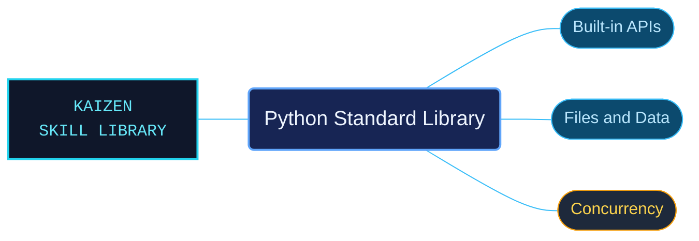

# Python Standard Library

Python 3.14 standard-library references for locating built-ins, modules and their API contracts. Focused topic catalogs let an agent move from a module name to its documented arguments, return behavior and platform conditions.

Use for the Python 3.14 standard library: built-in functions, types and exceptions; typing and collections; text, binary data and mathematics; files, databases and archives; operating systems, concurrency and asyncio; networking, email, web protocols and markup; GUI tools, testing, debugging, importing and interpreter services.

## What this skill helps with

| Task | Useful reference material |
| --- | --- |
| [Check built-in functions](functions/INDEX.md) | Look up function contracts and their version conditions. |
| [Work with filesystem paths](pathlib/INDEX.md) | Find path operations and platform-dependent behavior. |
| [Use asynchronous APIs](asyncio-api-index/INDEX.md) | Navigate the asyncio interfaces and their runtime requirements. |

## The work behind the references

The large library reference is divided into subject-owned files and catalogs, retaining examples, signatures and version restrictions with the APIs they explain.

## Start here

Start with [SKILL.md](SKILL.md) and follow its context routes.

Match the documented Python version and platform. Use the separate language-reference area for core syntax, execution semantics and object protocols.

## Sources and license

Skill reference documentation is interpreted content for use in open source projects. Check against [official documentation sources](https://docs.python.org/3.14/) when dealing with defects or issues that may come up from interpreting this skill's references.

Licensed under **Apache-2.0**; see [LICENSE](../../LICENSE). Part of the [Agent Kaizen](https://github.com/LevyBytes/agent-kaizen) skill library.
