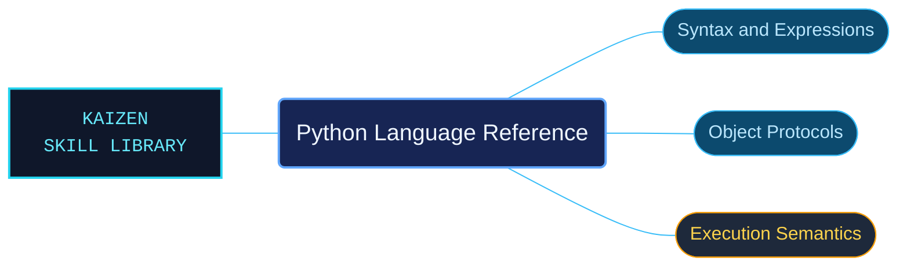

# Python Language Reference

The Python 3.14 language reference organized for exact semantic questions. Lexical rules, statements, object behavior, imports and execution have distinct routes so an agent can check a language contract without relying on tutorial shorthand.

Use when checking the Python 3.14 language definition: lexical analysis, literals, object data model and special methods, name binding and execution, imports, expression semantics, simple and compound statements, top-level execution or PEG grammar.

## What this skill helps with

| Task | Useful reference material |
| --- | --- |
| [Check object behavior](data-model/INDEX.md) | Find object protocols and special-method contracts. |
| [Understand execution](execution-model/INDEX.md) | Look up name binding, scopes and execution rules. |
| [Inspect expression semantics](expressions/INDEX.md) | Check the evaluation rules for expressions and operators. |

## The work behind the references

Language-definition material is grouped by semantic responsibility, preserving grammar, examples and qualifications with their explanations.

## Start here

Start with [SKILL.md](SKILL.md) and follow its context routes.

Use this area for language contracts. The tutorial and standard-library areas provide separate learning and module-level guidance.

## Sources and license

Skill reference documentation is interpreted content for use in open source projects. Check against [official documentation sources](https://docs.python.org/3.14/) when dealing with defects or issues that may come up from interpreting this skill's references.

Licensed under **Apache-2.0**; see [LICENSE](../../LICENSE). Part of the [Agent Kaizen](https://github.com/LevyBytes/agent-kaizen) skill library.
