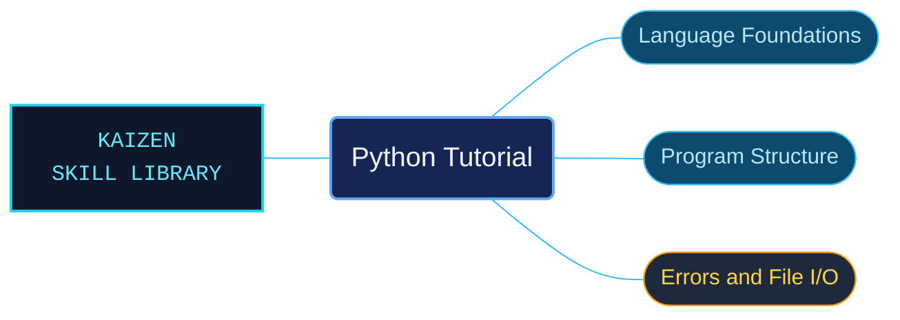

# Python Tutorial

A routed Python 3.14 tutorial for readers who already have programming experience. The material follows core syntax and data structures into functions, modules, classes, exceptions and practical standard-library use.

Use when learning Python 3.14 with prior programming experience: interpreter use, arithmetic, strings, lists, control flow, functions, data structures, modules, classes, errors, file I/O, standard-library examples, floating point, virtual environments or packages.

## What this skill helps with

| Task | Useful reference material |
| --- | --- |
| [Learn control flow](controlflow/INDEX.md) | Work through statements, functions and related examples. |
| [Choose data structures](datastructures/INDEX.md) | Explore the tutorial treatment of collections and their use. |
| [Structure programs with classes](classes/INDEX.md) | Find the introduction to classes and object-oriented program structure. |
| [Handle program errors](errors/INDEX.md) | Study exceptions and the tutorial error-handling examples. |

## The work behind the references

Tutorial subjects retain their teaching sequence while being divided into focused references with linked setup and examples.

## Start here

Start with [SKILL.md](SKILL.md) and follow its context routes.

Use the subject index to continue into modules, exceptions, file I/O, virtual environments and library examples. Consult the formal reference when exact language rules are required.

## Sources and license

Skill reference documentation is interpreted content for use in open source projects. Check against [official documentation sources](https://docs.python.org/3.14/) when dealing with defects or issues that may come up from interpreting this skill's references.

Licensed under **Apache-2.0**; see [LICENSE](../../LICENSE). Part of the [Agent Kaizen](https://github.com/LevyBytes/agent-kaizen) skill library.
