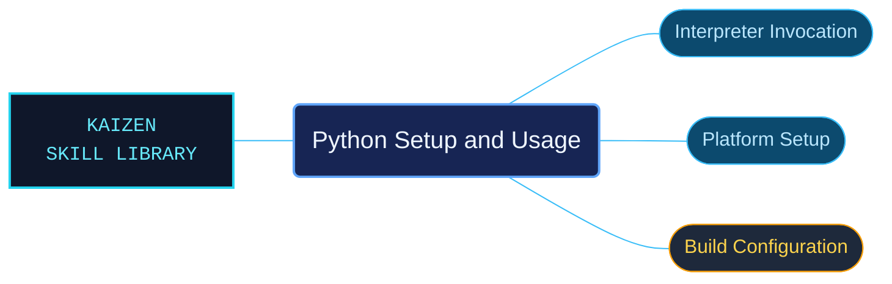

# Python Setup and Usage

Python 3.14 setup and interpreter-use references for selecting how Python is installed, built and launched. Platform-specific routes separate command-line behavior from the operating-system requirements that shape it.

Use when configuring or invoking Python 3.14, choosing command-line options and environment variables, building CPython, or installing and embedding Python on Unix, Windows, macOS, Android or iOS.

## What this skill helps with

| Task | Useful reference material |
| --- | --- |
| [Configure interpreter invocation](command-line/INDEX.md) | Look up command-line options and environment behavior. |
| [Use Python on Windows](windows/INDEX.md) | Find the bundled Windows installation and execution guidance. |
| [Build the interpreter](build-configuration/INDEX.md) | Check configuration options and build requirements. |

## The work behind the references

Invocation, build and platform material have separate indexes, retaining operating-system and interpreter-version conditions with their procedures.

## Start here

Start with [SKILL.md](SKILL.md) and follow its context routes.

Select the route for Unix, Windows, macOS, Android or iOS as appropriate. These references describe Python setup; they do not change the runtime used by an agent session.

## Sources and license

Skill reference documentation is interpreted content for use in open source projects. Check against [official documentation sources](https://docs.python.org/3.14/) when dealing with defects or issues that may come up from interpreting this skill's references.

Licensed under **Apache-2.0**; see [LICENSE](../../LICENSE). Part of the [Agent Kaizen](https://github.com/LevyBytes/agent-kaizen) skill library.
