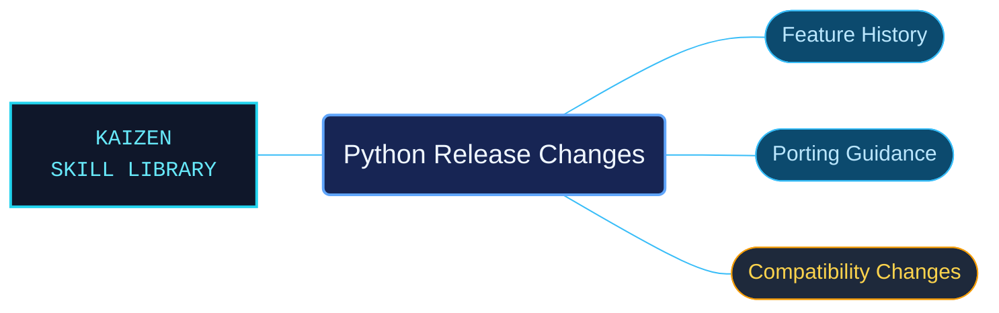

# Python Release Changes

Historical Python release references for understanding when features changed and what migrations required. Version-specific guides keep new behavior, compatibility notes and removals tied to the release that introduced them.

Use when researching historical Python release changes, new language or standard-library features, PEP introductions, compatibility changes, deprecations, removal schedules, porting guidance or dated CPython maintenance/prerelease fixes. Bundled Python 3.14 documentation includes Python 2.0–2.7 and 3.0–3.14 feature guides and changelog histories. Not a claim of current runtime availability or a substitute for the current API reference.

## What this skill helps with

| Task | Useful reference material |
| --- | --- |
| [Review Python 3.14 changes](release-3-14/INDEX.md) | Find the bundled 3.14 feature and porting material. |
| [Compare Python 3.13 behavior](release-3-13/INDEX.md) | Inspect the preceding version's documented changes. |
| [Explore release history](INDEX.md) | Select other bundled Python 2.x and 3.x release guides. |

## The work behind the references

Release material is organized chronologically by named version, preserving dated maintenance and prerelease context rather than merging it into current API claims.

## Start here

Start with [SKILL.md](SKILL.md) and follow its context routes.

Historical notes apply only to their named versions. Use the current task's language or library reference to establish its API contract.

## Sources and license

Skill reference documentation is interpreted content for use in open source projects. Check against [official documentation sources](https://docs.python.org/3.14/) when dealing with defects or issues that may come up from interpreting this skill's references.

Licensed under **Apache-2.0**; see [LICENSE](../../LICENSE). Part of the [Agent Kaizen](https://github.com/LevyBytes/agent-kaizen) skill library.
